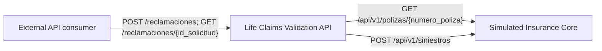

# C4 Level 1 - System Context

## Purpose

Life Claims Validation is a REST service for validating
and registering life insurance claims.

## System context diagram

## Responsibilities

### External API consumer

Submits claim requests and retrieves their processing status.
No specific frontend application is assumed.

### Life Claims Validation API

- Validates claim requests and business rules R1-R8.
- Coordinates policy lookup and claim registration.
- Maintains request-level idempotency.
- Persists claim processing results.
- Exposes REST endpoints and an OpenAPI contract.

### Simulated Insurance Core

- Provides operational policy information.
- Registers insurance claims.
- Receives an Idempotency-Key header during registration.

## System boundary

The simulated Core is an external dependency.
The confidential Core simulator is not included in Git.
CSV policy data is used for analytics, not authoritative
operational policy validation.

## Technology overview

- Python 3.12
- FastAPI and Uvicorn
- HTTPX for Core communication
- SQLite for claim persistence
- Docker and GitHub Actions
