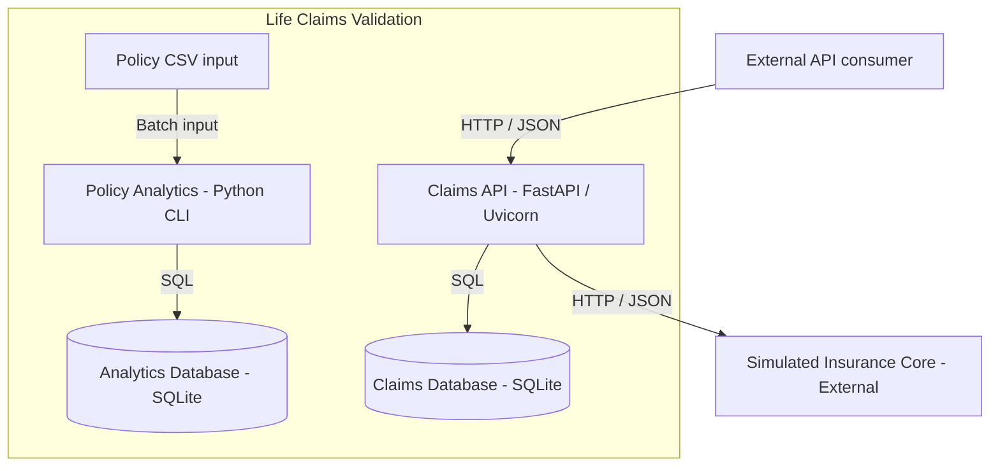

# C4 Level 2 - Containers

## Purpose

Describe the executable and storage boundaries of
the Life Claims Validation solution.

## Container diagram

## Claims API

Technology: Python 3.12, FastAPI, Uvicorn.

Responsibilities:
- Expose REST endpoints and OpenAPI.
- Orchestrate claims validation and registration.
- Apply business rules R1-R8.
- Integrate with the external insurance Core.
- Persist claim results.

Deployment:
- Docker container port: 8000.
- Local host port: 8001.
- Core URL configured using CORE_BASE_URL.

## Claims Database

Technology: SQLite.
Path in Docker: /app/data/claims.db.
Persistence: named Docker volume claims-data.
Schema: datos/migrations/001_create_claims.sql.

## Policy Analytics

Technology: Python batch/CLI modules and SQLite.

Responsibilities:
- Import policy CSV records.
- Produce data-quality reports.
- Execute SQL KPI queries.

The analytics process is not a permanently running
service in the current Docker Compose configuration.
The analytics database is logically separate from
the operational claims database.

## Simulated Insurance Core

External dependency accessed through HTTPX.

Operations:
- GET /api/v1/polizas/{numero_poliza}
- POST /api/v1/siniestros

The Core simulator is excluded from the repository
and from the claims API Docker image.

## Architecture constraints

- SQLite is used for the technical assessment.
- PostgreSQL is not currently implemented.
- No message broker or background worker is deployed.
- Pending Core confirmations are not automatically reconciled.
- CSV analytics data is not the authoritative policy source.
