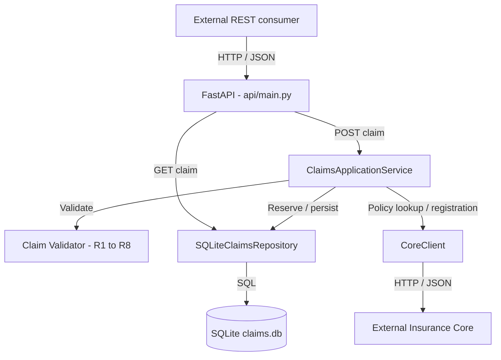

# C4 Level 3 - Claims API Components

## Scope

This diagram describes the internal components of the
FastAPI application. All components execute in the same
Python application container.

## Component diagram

## Components

### API layer

Files: api/main.py and api/schemas.py.
Validates request structure and maps application states
to HTTP responses.

### Application layer

File: application/claims_service.py.
Coordinates reservation, policy lookup, business
validation, Core registration and persistence.

### Domain layer

Files: domain/claim_validator.py, date_rules.py,
policy_rules.py, duplicate_rules.py and claim_normalizer.py.
Implements claim validation and event identity.

### Persistence adapter

File: infrastructure/sqlite_claims_repository.py.
Handles request idempotency, business-event reservation,
claim state updates and retrieval.

### Core HTTP adapter

Files: infrastructure/core_client.py and
infrastructure/core_http_factory.py.
Uses HTTPX and configurable CORE_BASE_URL.

## Claim registration sequence

1. FastAPI validates the incoming request.
2. The service reserves the request in SQLite.
3. An existing request returns its stored outcome.
4. A business duplicate is handled according to R8.
5. The service retrieves the policy from the Core.
6. Domain rules R1-R8 are evaluated.
7. Invalid claims are persisted as REJECTED.
8. Valid claims are submitted to the Core.
9. Successful registration is persisted as REGISTERED.
10. Registration timeout produces PENDING_CONFIRMATION.

## Known limitations

- Core policy lookup failures are not explicitly
  translated into application-level recovery states.
- Automatic reconciliation of pending claims is absent.
- SQLite concurrency differs from PostgreSQL.
- No background worker or event broker is deployed.
